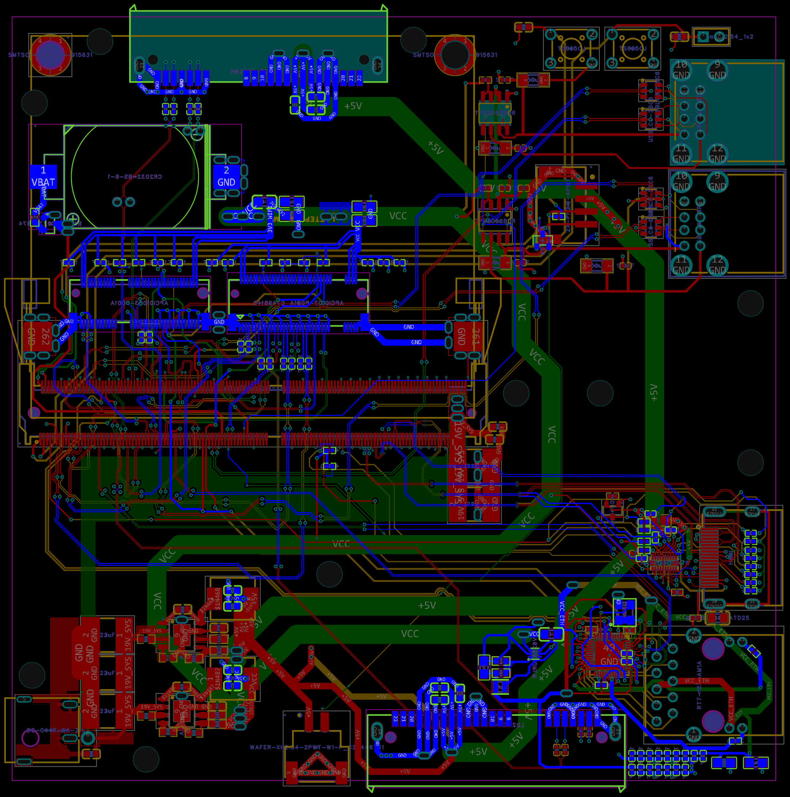

[← Back to Root](../README.md)

# PCB Layout & Fabrication

Custom PCB layout, component placement, high-speed differential routing, and production fabrication files for Project μAtlas, designed in EasyEDA Pro for JLCPCB manufacturing.

---

## Board Preview

### Board Renders & Views

Detailed board screenshots and 3D preview renders from EasyEDA Pro are saved in [`../Resources/PCB_Images/`](../Resources/PCB_Images/):
* [Render 1 — 3D Top View](../Resources/PCB_Images/Screenshot%202026-10-24%20120110.png)
* [Render 2 — Isometric View](../Resources/PCB_Images/Screenshot%202026-10-24%20120121.png)
* [Render 3 — Bottom View](../Resources/PCB_Images/Screenshot%202026-10-24%20120139.png)
* [Render 4 — Layer Routing](../Resources/PCB_Images/Screenshot%202026-10-24%20120157.png)

---

## Specifications

| Parameter | Specification | Notes |
|---|---|---|
| **Form Factor** | 100 x 100 mm | Standard square carrier board form factor |
| **Layer Count** | 6 Layers | Top, Inner 1, Inner 2, Inner 3, Inner 4, Bottom with solid ground planes |
| **High-Speed Interfaces** | PCIe Gen 3.0, 2.5GbE, HDMI 2.0, USB 3.2 Gen 2 | Length-tuned differential pairs with AC coupling capacitors |
| **Power Rails** | 19V SYS, 5V, 3.3V, 0.9V (Ethernet PHY), 1.5V (USB Hub) | Decoupled with localized ceramic capacitor arrays |
| **EDA Tool** | EasyEDA Pro | Migrated from Standard for advanced differential pair routing |

---

## Manufacturing & Assembly Files

Production-ready manufacturing packages for ordering PCB fabrication and SMT assembly:

| File | Type | Description |
|---|---|---|
| [Gerber_μAtlas_PCB_2026-10-24.zip](./Fabrication/Gerber_%CE%BCAtlas_PCB_2026-10-24.zip) | Gerbers & Drills | RS-274X Gerber layers & Excellon NC drill package for 6-layer manufacturing |
| [PickAndPlace_μAtlas_PCB_2026_10_24.csv](./Fabrication/PickAndPlace_%CE%BCAtlas_PCB_2026_10_24.csv) | Centroid / CPL | SMT component placement coordinates and rotations for automated pick-and-place |
| [BOM.csv](../BOM/BOM.csv) | Bill of Materials | Component list with LCSC part numbers and designators for SMT assembly |

---

## Project Design Files

| File | Description |
|---|---|
| [PCB_μAtlas_PCB_2026-10-24.png](./PCB_μAtlas_PCB_2026-10-24.png) | Latest 2D PCB layout render (2026-10-24) |
| [ProPrj_μAtlas-Pro_2026-10-24.epro](./ProPrj_μAtlas-Pro_2026-10-24.epro) | Full EasyEDA Pro project archive (schematics + board layout) |
