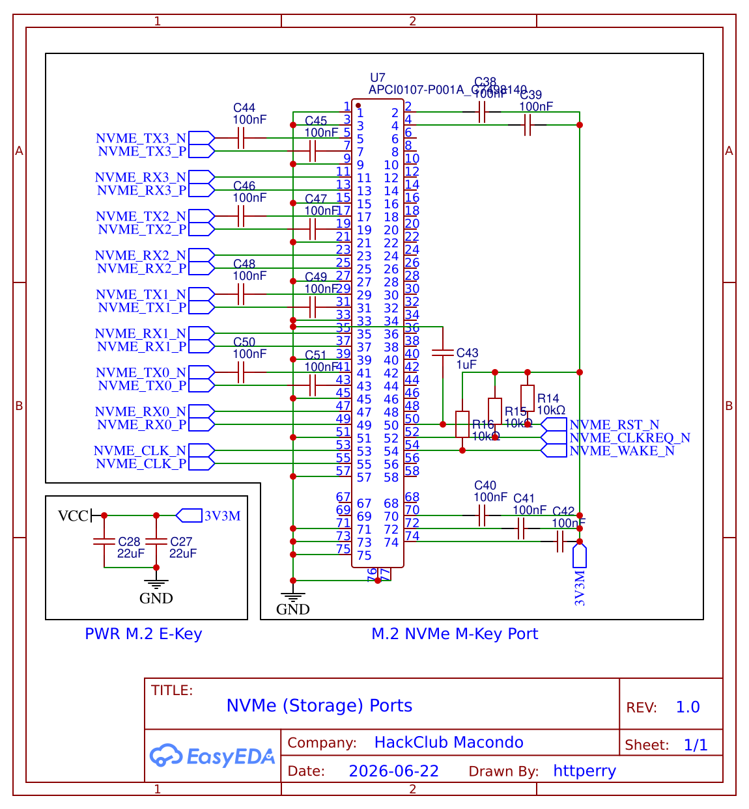

[← Back to NVMe Connections](../README.md) · [← Back to Schematics](../../README.md) · [← Back to Root](../../../README.md)

# NVMe — Storage (M.2 M-Key)

**Revision 1.0** — Drawn by httperry · HackClub Macondo · 2026-06-22

M.2 M-Key (2280/2242) storage interface schematic utilizing 4x PCIe Gen 3.0 lanes from the LattePanda Mu for high-speed NVMe SSD drives.

---

## Schematic

## Downloads

| File | Description |
|---|---|
| [Schematic_Atlas_2026-06-22.png](./Schematic_Atlas_2026-06-22.png) | Schematic export (PNG) |
| [Schematic_Atlas_2026-06-22.svg](./Schematic_Atlas_2026-06-22.svg) | Schematic export (SVG) |
| [Schematic_Atlas_2026-06-22.pdf](./Schematic_Atlas_2026-06-22.pdf) | Schematic export (PDF) |
| [SCH_μAtlas_2026-06-22.json](./SCH_%CE%BCAtlas_2026-06-22.json) | EasyEDA source (JSON) |
| [NVMe_(Storage)_Ports.schdoc](./NVMe_(Storage)_Ports.schdoc) | Schematic document |
| [87e84a7d-4a42-41b4-bb6e-7de45a3cd594-0003.png](../87e84a7d-4a42-41b4-bb6e-7de45a3cd594-0003.png) | EasyEDA Pro multi-sheet export (PNG) |
