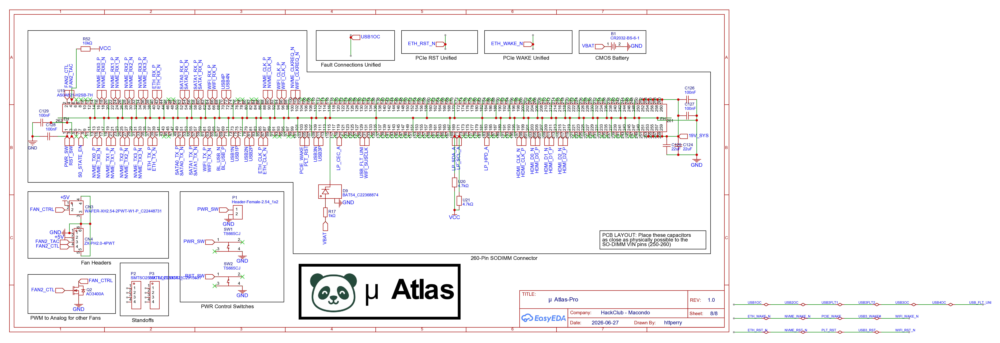

[← Back to Schematics](../README.md) · [← Back to Root](../../README.md)

# SO-DIMM Connections (LattePanda Mu)

**Revision 1.0** — Drawn by httperry · HackClub Macondo

LattePanda Mu 260-pin DDR4 SO-DIMM form-factor compute module interface schematic. Exposes PCIe lanes, SATA channels, USB 2.0 / 3.2, DDI (HDMI), power rails, and control signals from the Intel N100 SoM.

---

## Schematic

## Downloads

| File | Description |
|---|---|
| [87e84a7d-4a42-41b4-bb6e-7de45a3cd594-0007.png](./87e84a7d-4a42-41b4-bb6e-7de45a3cd594-0007.png) | Schematic export (PNG) |
| [LattePanda Mu Edge Pinout](https://github.com/LattePandaTeam/LattePanda-Mu/blob/main/Electricals/Pinouts/LattePanda_Mu_Edge_Connector_Pinout.xlsx) | Official pinout reference spreadsheet |
